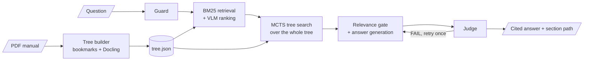

# PDF MCTS Agent — Vectorless RAG for PDF Manuals

Ask questions about a technical PDF manual and get answers that cite the exact sections they came from.
The PDF's own table of contents is turned into a section tree; a LangGraph agent then finds the right
section by **searching that tree with a VLM-guided Monte Carlo Tree Search** — no embeddings and no
vector database.

- **Tree builder** — PDF bookmarks (or a synthetic TOC) + Docling content extraction → `tree.json`.
- **Query agent** — LangGraph pipeline: guard → query expansion → BM25 retrieval → VLM ranking →
  MCTS tree search → relevance-gated answer generation → judge (with one retry).
- **Streamlit app** — upload a PDF, build and explore its tree, ask questions, rate answers.

## How it works



1. **Ingest once.** The manual becomes a tree of sections (chapters → sections → subsections),
   each holding its text and tables and its page range.
2. **Retrieve.** BM25 finds candidate sections; a VLM scores each one for relevance.
3. **Search the tree.** MCTS descends from the chapters, scoring each node's children with the VLM
   — chapters by their subsection titles, leaves by their content — and homes in on the section
   that holds the answer. It can reach sections that share no words with the question.
4. **Answer from verified evidence.** A per-section YES/NO gate keeps only sections that actually
   answer the question; the generator answers from those and cites them by title and page.
5. **Check.** A judge verifies safety and grounding, and triggers one retry on failure.

Every VLM-backed stage has a deterministic fallback, so a degraded model server slows the agent
down instead of breaking it. **For the full design — every node, the MCTS algorithm, the state
model, the VLM client, configuration, measured results, and known limitations — read the
[Agent Architecture Guide](langgraph_agent.md).**

## Project layout

```text
src/
  app.py              Streamlit UI (auth, upload, tree explorer, chat, feedback)
  tree_builder/       PDF -> tree.json (bookmarks, Docling, section matching, export)
  validation/         tree.json integrity checks (coverage, page precision, structure)
  rag/                BM25 index, evidence expander, MCTS explorer, tree loader
  agent/              LangGraph graph, nodes, prompts, state, routing
  models/             Pydantic models (Section, EvidenceBundle, MCTS state, ...)
  vlm/                The only module that calls the model server (retries, pacing)
  persistence/        SQLite: users, feedback, corrections, MCTS runs
scripts/              CLI tools: build_tree, validate_tree, query, view_memory, reset_state
tests/                Unit tests (no network needed)
langgraph_agent.md    Agent Architecture Guide
```

## Requirements

- Python >= 3.12
- [uv](https://docs.astral.sh/uv/) (dependency manager)
- Access to a VLM server (self-hosted, Qwen2.5-VL-7B via vLLM, OpenAI-compatible API) for ranking, MCTS scoring, answer generation and judging
- (Optional) HuggingFace token for faster/authenticated Docling model downloads

## Install

```bash
cd pdf_mcts_agent
uv sync
```

This creates `.venv/` and installs all dependencies from `pyproject.toml` / `uv.lock` (including dev tools: pytest, ruff, mypy).

## Configure

```bash
cp .env.example .env
```

Edit `.env`:

```dotenv
HF_TOKEN=                 # optional, HuggingFace Hub token (Docling model download)
LLM_BASE_URL=https://<VLM_HOST>/v1   # VLM server URL
LLM_API_KEY=              # required — call_vlm() raises RuntimeError if unset
LLM_MODEL=Qwen2.5-VL-7B
```

## Run the app

```bash
uv run streamlit run src/app.py
```

Opens the Streamlit UI (default `http://localhost:8501`). Flow: **Upload PDF → Build tree → Explore tree → Query**.

## Run the scripts

All scripts must be run from the repository root (they insert the project root onto `sys.path`).

### `scripts/build_tree.py` — build tree.json from a PDF

```bash
uv run python scripts/build_tree.py <pdf_path> [-o output_path] [--no-docling] [-v]
```

- Guards against corrupt/encrypted/empty PDFs (clear error, no crash) and sanity-checks bookmark structure (warns on out-of-range/negative/duplicate/empty-title bookmarks; aborts only on out-of-order page numbers).
- No embedded TOC bookmarks: falls back to a synthetic TOC inferred from Docling's detected headings (`structural_source: "inferred"` in the output vs `"toc"` for the normal path). Aborts only if Docling also finds no headings.
- Runs `validate_tree`'s 3 checks automatically after writing — logs a warning on FAIL but never aborts the build (the file is written either way).
- `--no-docling`: skip content extraction, build structure from bookmarks only (no `semantic_nodes`) — also disables the synthetic-TOC fallback, since it depends on Docling headings.
- `-v`: verbose/debug logging.

### `scripts/validate_tree.py` — validate tree.json against source PDF

```bash
uv run python scripts/validate_tree.py <tree_json> <pdf_path> [--docling-blocks N]
```

- `--docling-blocks`: total docling blocks (text+tables) used for coverage check. Defaults to the tree's own node count if omitted.
- Exits `0` on `PASS`, `1` otherwise.

### `scripts/query.py` — query a tree.json with the MCTS RAG pipeline

```bash
uv run python scripts/query.py --tree <tree_json> --query "<question>" \
    [--db data/rag.db] [--thread-id ID] [--no-vlm-mcts] [-v]
```

- `--no-vlm-mcts`: disable VLM scoring in MCTS, use heuristic only.
- `--db`: SQLite DB path (created if missing), defaults to `data/rag.db`.

### `scripts/view_memory.py` — inspect conversation feedback history

```bash
uv run python scripts/view_memory.py                          # list conversations
uv run python scripts/view_memory.py <conversation_id>        # show full history
uv run python scripts/view_memory.py <conversation_id> --with-corrections
```

Reads the `feedback` table in `data/mvp.db` (question/answer/judge verdict/rating history). Note: LangGraph chat state itself is session-only (never persisted); this is the durable feedback record.

### `scripts/reset_state.py` — wipe local runtime state

```bash
uv run python scripts/reset_state.py            # dry run — shows what would be deleted
uv run python scripts/reset_state.py --yes       # actually delete
```

Deletes SQLite DBs (`data/*.db` — users/feedback/mcts_runs/etc.), uploaded user documents (`data/users/*`), conversation logs (`logs/*`), and dev tool caches (`.pytest_cache`, `.ruff_cache`, `.mypy_cache`, `__pycache__`). None of this is version-controlled, so it's irreversible. Defaults to a dry run; add `--yes` to actually delete. Use `--keep-db` / `--keep-users` / `--keep-logs` / `--keep-cache` to exclude a category.

## Tests

```bash
uv run pytest
```

## Lint / typecheck

```bash
uv run ruff check .
uv run mypy .
```

## Docs

- [langgraph_agent.md](langgraph_agent.md) — Agent Architecture Guide: pipeline topology, node-by-node behaviour, the MCTS tree search, answer gating and judging, state and memory, VLM client, configuration, design decisions with measured results, and known limitations

## Deployment (Docker + AWS ECR) — for QA distribution

The business logic in `src/` (agent, rag, tree_builder, persistence, validation, vlm) is compiled
with Cython into `.so` extension modules before shipping — QA gets a runnable Docker image, never
the Python source. Config-only pydantic schemas (`src/models/derived.py`, `evidence.py`, `mcts.py`,
`section.py`) stay as plain `.py` because Cython-compiled methods break pydantic's class inspector.

Everything is driven by the `Makefile`. Full target list: `make help`.

### One-time AWS setup (already done for this project)

- Private ECR repo `mvp-v2` (scan-on-push enabled, `MUTABLE` tags so `:latest` can be overwritten).
- Lifecycle policy: untagged images expire after 7 days, only the last 10 tagged images are kept.
- IAM policy `mvp-v2-qa-ecr-pull` — pull-only (no push, no other AWS access).
- Setup script (idempotent, re-run if the repo/policy ever needs recreating):
  ```bash
  AWS_REGION=us-east-1 AWS_ACCOUNT_ID=<AWS_ACCOUNT_ID> bash scripts/aws_ecr_setup.sh
  ```

### Publishing a new version (developer)

Authenticate once per session (SSO token lasts a few hours):

```bash
aws sso login --profile mvp-v2-admin
export AWS_PROFILE=mvp-v2-admin
```

Then, after making changes:

```bash
make deploy AWS_REGION=us-east-1 AWS_ACCOUNT_ID=<AWS_ACCOUNT_ID>
```

This runs the full pipeline in order — pytest against plain sources, a Cython compile + pytest
pass against the compiled `.so` (in a scratch copy, discarded after — catches Cython breakage
before the slow step), a local single-arch Docker build, and a health-check smoketest. Only if
all of that passes does it build multi-arch (`linux/amd64` + `linux/arm64`) and push two tags to
ECR: `:latest` (what QA always pulls) and `:<git-short-sha>` (fixed reference for rollback/audit).

Other useful targets: `make all` (everything above except the ECR push — fast local sanity
check), `make run` (run the locally built image in the foreground against your real `.env`).

### Onboarding a QA member (developer, one-time per person)

```bash
QA_USER=qa-<name>
aws iam create-user --user-name "$QA_USER" --profile mvp-v2-admin
aws iam attach-user-policy --user-name "$QA_USER" \
    --policy-arn arn:aws:iam::<AWS_ACCOUNT_ID>:policy/mvp-v2-qa-ecr-pull --profile mvp-v2-admin
aws iam create-access-key --user-name "$QA_USER" --profile mvp-v2-admin
```

The last command prints an `AccessKeyId` + `SecretAccessKey` **once** — send it to that QA member
over a secure channel (password manager, Slack DM with expiring link, etc.), never in plain
email/chat/git. It cannot be retrieved again; if lost, delete the key and create a new one.

### Consuming the image (QA)

One-time setup, using the access key you were given:

```bash
aws configure --profile mvp-v2-qa
# AWS Access Key ID: <paste>
# AWS Secret Access Key: <paste>
# Default region: us-east-1
# Default output format: json
```

Every time you want to run the app (repeat the login step if it's been a while — the ECR token
expires after ~12h):

```bash
aws ecr get-login-password --region us-east-1 --profile mvp-v2-qa | \
    docker login --username AWS --password-stdin <AWS_ACCOUNT_ID>.dkr.ecr.us-east-1.amazonaws.com

docker pull <AWS_ACCOUNT_ID>.dkr.ecr.us-east-1.amazonaws.com/mvp-v2:latest

mkdir -p data logs
docker run --rm -p 8501:8501 --env-file .env \
    -v "$(pwd)/data:/app/data" -v "$(pwd)/logs:/app/logs" \
    <AWS_ACCOUNT_ID>.dkr.ecr.us-east-1.amazonaws.com/mvp-v2:latest
```

Open `http://localhost:8501`. You need your own `.env` (copy `.env.example` and fill in real
values) — it is never baked into the image.

### Logs and data (both local `make run` and the image above)

The container writes to `data/` (`mvp.db` + uploaded PDFs under `data/users/`) and `logs/`
(one `.log` + `.json` audit-trail pair per query) — both mounted from your machine via `-v`
above, so they persist across restarts and are visible on the host, not just inside the
container. To watch them live while the app runs:

```bash
tail -f logs/*.log
```
