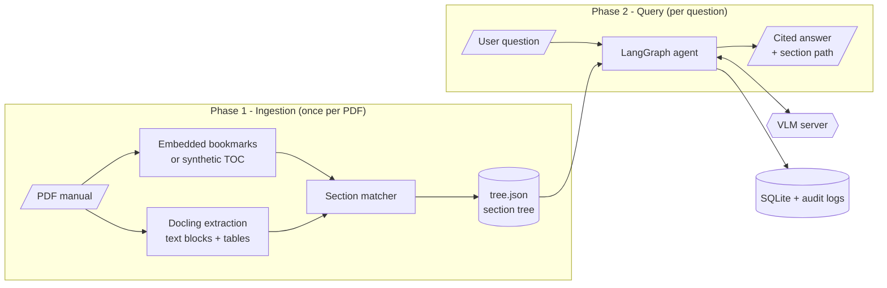
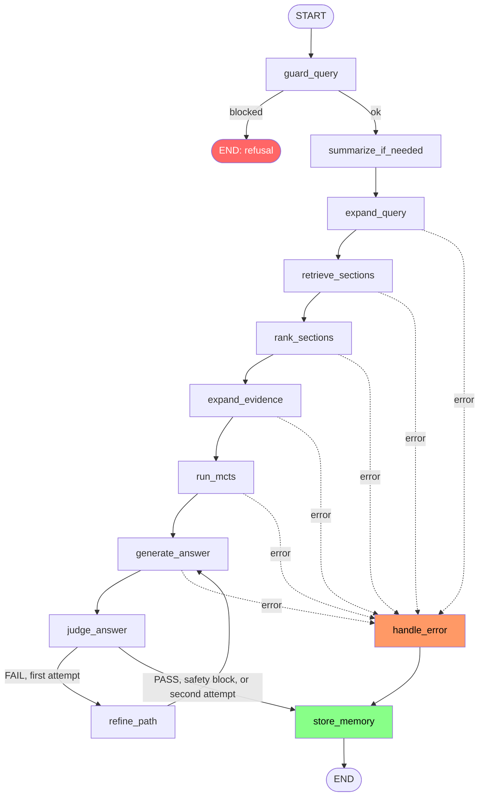

# Agent Architecture Guide

How the PDF MCTS Agent turns a PDF manual into a searchable tree and answers questions over it
with a LangGraph pipeline, VLM-guided tree search, and grounded answer generation.

**Audience:** engineers who need to understand, debug, or extend the agent.
**Source of truth:** the code. The graph topology below mirrors `src/agent/graph.py`
(`build_graph`); file references point to where each behaviour lives.

## Contents

1. [Overview](#1-overview)
2. [System at a glance](#2-system-at-a-glance)
3. [Phase 1 — Document ingestion](#3-phase-1--document-ingestion)
4. [Phase 2 — The query agent](#4-phase-2--the-query-agent)
5. [MCTS tree search in depth](#5-mcts-tree-search-in-depth)
6. [Answer generation and the relevance gate](#6-answer-generation-and-the-relevance-gate)
7. [The judge and the retry loop](#7-the-judge-and-the-retry-loop)
8. [State and conversation memory](#8-state-and-conversation-memory)
9. [The VLM client](#9-the-vlm-client)
10. [Persistence and observability](#10-persistence-and-observability)
11. [Configuration reference](#11-configuration-reference)
12. [Design decisions and measured results](#12-design-decisions-and-measured-results)
13. [Known limitations](#13-known-limitations)
14. [Where to change things](#14-where-to-change-things)

---

## 1. Overview

The agent answers questions about technical PDF manuals (service guides, operator manuals,
specifications). It is **vectorless**: there are no embeddings and no vector database. Retrieval
relies on three signals instead:

| Signal | Used for | Cost |
|---|---|---|
| **BM25** (lexical) | Candidate retrieval and an exploration prior for the tree search | local, ~ms |
| **The document's own structure** (its table of contents, as a tree) | What MCTS navigates; how evidence is expanded (parent / sibling / child) | none |
| **VLM judgments** (a self-hosted Qwen2.5-VL-7B behind an OpenAI-compatible API) | Ranking, tree navigation, relevance gating, answer synthesis, grading | network, ~1 s per call |

Why this design: a manual already carries an author-written index of itself. Navigating that
index the way a person would — read the chapter titles, open the promising chapter, read its
subsection titles, descend — keeps retrieval explainable (every answer comes with the section path
that led to it) and avoids an embedding pipeline to host, version, and re-index.

Two properties shape most of the code:

- **The VLM is small (7B) and sometimes wrong.** The pipeline asks it short, single-purpose
  questions (score one section, answer YES/NO about one section) instead of one large judgment,
  and every VLM-backed stage has a deterministic fallback.
- **Answers must be grounded.** The answer generator only sees evidence the pipeline has
  verified, cites sections by title and page, and is checked by a separate judge.

## 2. System at a glance



The two phases only share `tree.json`. The Streamlit app (`src/app.py`) drives both; the CLI
scripts in `scripts/` run them separately.

## 3. Phase 1 — Document ingestion

Entry point: `scripts/build_tree.py` (or the upload flow in `src/app.py`). Code: `src/tree_builder/`.

1. **Load and validate the PDF** — `fitz_toc.py` (PyMuPDF). Corrupt, encrypted, or empty files
   fail with a specific `PDFLoadError` rather than crashing later.
2. **Get the structure.**
   - *Normal path:* the PDF's embedded bookmarks (`fitz.get_toc()`), checked by
     `bookmark_sanity.py` (out-of-range pages, duplicates, empty titles are reported; only
     out-of-order page numbers abort). Sections get `structural_source = "toc"`.
   - *No bookmarks:* `synthetic_toc.py` infers a TOC from the section headings Docling detects
     (`structural_source = "inferred"`).
3. **Extract content** — `docling_extract.py` (Docling) in windows, producing text blocks and
   tables with page numbers, bounding boxes, and a global reading order.
4. **Match content to sections** — `section_matcher.py`. Page ranges come from the bookmarks;
   the parent/child hierarchy comes from bookmark levels; text blocks are assigned by
   *reading-order interval anchored to each section's own heading block*, not by page alone
   (sibling sections that share a page would otherwise starve each other). Tables are assigned
   by page, a known coarser fallback.
5. **Export** — `tree_export.py` writes `tree.json`: a flat list of sections, each with its
   `semantic_nodes` (paragraphs / tables), `parent_section_id`, `child_sections`, page range, and
   `structural_source`.
6. **Validate** — `src/validation/tree_validator.py` runs three checks automatically (coverage:
   every block lands in exactly one section; precision: blocks fall inside their section's page
   range; structure: hierarchy matches the bookmarks). A failure logs a warning; the file is
   still written.

At query time `src/rag/loader.py` turns `tree.json` into immutable pydantic `Section` objects
(`src/models/section.py`):

| Field | Meaning |
|---|---|
| `section_id`, `title`, `hierarchy_level`, `hierarchy_path` | Identity and position in the tree |
| `semantic_nodes` | The section's content blocks (`canonical_text`, order, type) |
| `node_count` | Number of content blocks. Chapters are often only their heading (1–3 nodes) |
| `child_sections` | Ids of direct children — this is the tree edge |
| `page_start`, `page_end` | Page range, used for citations |
| `confidence`, `structural_source` | Provenance. All `"toc"` sections have confidence 1.0 |

## 4. Phase 2 — The query agent

`DocumentReasoner` (`src/agent/graph.py`) builds the BM25 index, the evidence expander and the
MCTS explorer for one document and compiles the graph. `await reasoner.run(query, ...)` executes
one question.



Every fallible node returns `{"error": ..., "error_layer": ...}` instead of raising;
`route_on_error` sends the run to `handle_error`, which builds a best-effort answer from whatever
evidence exists, then to `store_memory` so even failed runs are recorded.

### Node reference

| # | Node | File | What it does |
|---|---|---|---|
| 1 | `guard_query` | `nodes/guard.py` | Scope and safety gate. A keyword fast path blocks obvious harmful terms with no VLM call; otherwise the VLM classifies `PASS` or `BLOCK:<category>` (`dangerous`, `mental_health`, `off_topic`, `social_engineering`). Also decides `is_followup`. **Fails open** on VLM error. |
| 2 | `summarize_if_needed` | `nodes/memory.py` | When the buffer exceeds 10 messages, VLM-summarises the older ones into `summary` and keeps the last 4. |
| 3 | `expand_query` | `nodes/retrieval.py` | VLM rewrites the question as 3 sub-questions, each covering a different aspect. Uses prior conversation only if `is_followup`. Falls back to the original question. |
| 4 | `retrieve_sections` | `nodes/retrieval.py` | BM25 candidates (top 30). See [Retrieval](#retrieval). |
| 5 | `rank_sections` | `nodes/retrieval.py` | VLM scores every candidate, combined with BM25; keeps the top 12. See [Ranking](#ranking). |
| 6 | `expand_evidence` | `nodes/retrieval.py` | Builds the evidence bundle around the ranked sections. See [Evidence expansion](#evidence-expansion). |
| 7 | `run_mcts` | `nodes/mcts.py` | Tree search over the whole document. See [section 5](#5-mcts-tree-search-in-depth). |
| 8 | `generate_answer` | `nodes/answer.py` | Relevance gate, then answer synthesis. See [section 6](#6-answer-generation-and-the-relevance-gate). |
| 9 | `judge_answer` | `nodes/judge.py` | Safety and quality checks on the answer. See [section 7](#7-the-judge-and-the-retry-loop). |
| 10 | `refine_path` | `nodes/mcts.py` | Retry hook after a judge `FAIL`; feeds `generate_answer` directly. |
| 11 | `handle_error` | `nodes/persistence.py` | Fallback answer from partial state; clears the error flag. |
| 12 | `store_memory` | `nodes/persistence.py` | Persists the turn (SQLite), appends to `messages`, writes the audit log. Always runs. |

Routing predicates live together in `nodes/routing.py`:

- `route_after_guard` — `blocked` → END (no retrieval, no memory write); otherwise continue.
- `route_on_error` — any `state["error"]` → `handle_error`.
- `route_after_judge` — a safety block is final (`done`); a `FAIL` with fewer than 2 judge
  attempts → `refine`; everything else → `done`.

### Retrieval

`retrieve_sections` is lexical only (`src/rag/bm25_retrieval.py`):

- Three BM25 indexes per section — title (weight 3.0), hierarchy path (1.5), content (1.0) — with
  light suffix stemming; title and path also index bigrams (`system_fault`).
- Two ranked lists are fused with Reciprocal Rank Fusion (k = 60): the **user's original
  question** and the **sub-questions joined into one string**. The original keeps the user's
  exact terms (VLM sub-questions can drift); the joined sub-questions add vocabulary the user did
  not use. Fusing one list *per* sub-question was measured worse and is not used.

BM25 only seeds candidates. A section it misses is still reachable by the tree search.

### Ranking

`rank_sections` asks the VLM, for each of the 30 candidates in parallel (10 at a time), to rate
0.0–1.0 how relevant the section is, based mainly on its title and path. The composite is:

```text
score = 0.35 * bm25_normalised + 0.35 * vlm_score + 0.20 * confidence + 0.10 * depth_bonus
```

`depth_bonus` is `level / max_level` of the whole document (deeper = more specific). Today
`confidence` is 1.0 for every TOC-sourced section, so it does not affect ordering. The ranker
scores against the **original** question, and its VLM scores are kept in
`state["rank_vlm_scores"]` for MCTS to reuse.

### Evidence expansion

`src/rag/evidence_expander.py` turns the 12 ranked sections (the *primary* sections) into an
`EvidenceBundle`: their **parents**, up to 2 **siblings** each, all direct **children**, and a few
keyword-matched **related nodes** (capped; `related_nodes` is computed but not currently placed
in the answer prompt). The bundle is capped at 6× the primary count.

## 5. MCTS tree search in depth

`src/rag/mcts_explorer.py` (`MCTSExplorer`), configured by `MCTSConfig` (`src/models/mcts.py`).

### What it solves

BM25 and the ranker work on a flat list of sections. They cannot find a section that shares no
words with the question, and they ignore the hierarchy. The search navigates the **whole section
tree top-down** and can reach sections retrieval never surfaced.

### The tree

All sections form a tree via `child_sections`. A virtual root sits above the top-level chapters.
`MCTSExplorer` is constructed with the full section list, so it searches the whole document, not
only the evidence bundle.

### One simulation

1. **Select.** From the root, descend through already-expanded nodes by PUCT
   (`MCTSNode.puct`):
   `Q + prior_weight * prior + c * (0.25 + 0.75 * prior) * sqrt(N_parent) / (1 + n)`.
   `Q` is the node's mean reward once visited and **its own relevance score before that**, so an
   unvisited child that scored well is explored on merit rather than in list order.
   `prior` is the BM25 score of the best candidate in the node's subtree, normalised to `[0, 1]`.
   It biases order but never prunes: a floor keeps every subtree reachable.
2. **Expand.** At the first node whose children have not been scored, score *all* of its
   children with the VLM in one concurrent batch.
3. **Reward.** The best score at the expanded node — its own or any child's — i.e. how promising
   the subtree is.
4. **Backpropagate** the reward to the root.

### How nodes are scored

One VLM call per node (`rollout_scoring` task), asking how likely the answer is *in this section
or one of its subsections*:

- A **chapter** is judged by its title, path, and the **titles of its subsections** — like
  reading a table of contents.
- A **leaf** is judged by its title and its best-matching content.
- Leaves already scored by `rank_sections` reuse that score (no second call). For nodes with
  children, the navigation score is averaged with the ranker's score when both exist, which
  reduces single-call noise.
- If the VLM fails for a node, a lexical heuristic score is used instead; the run continues.

### Cost bounds

`max_expansions` (default 15) caps how many nodes get their children scored and
`max_vlm_calls` (150) is a hard ceiling. A typical query uses ~85 VLM calls and ~9 s in this
stage. Simulations that land on an already-scored leaf cost nothing.

### Result

`SearchState` returns:

- `top_ids` — the best sections, most relevant first. Ranking rules: sort by own score, but a
  **chapter yields to what is under it** — a title-only chapter (≤ 3 content nodes) is never the
  answer; a chapter whose children were never scored is penalised; a chapter whose child scores
  about as well defers to the child. Ties break on visit count, then prior. This stops a generic
  chapter the VLM likes (e.g. "Specifications") from outranking the real section.
- `best_path` — the chain from the top-level chapter down to the best section (shown in the UI as
  the "MCTS best path" and stored in SQLite).
- `score_cache`, `vlm_calls`, `vlm_fallbacks`, `expansions` — diagnostics.

`run_mcts` then **adds strong finds missing from the evidence** (score ≥ 0.8, at most 3, at most
60 content nodes each) to the front of the primary sections, so the answer prompt can use
sections the ranker did not surface.

> `refine_path` can call the same search with a pre-built score cache
> (`score_cache_override`), which skips all VLM scoring.

## 6. Answer generation and the relevance gate

`generate_answer` (`nodes/answer.py`) does **not** hand the 7B model the whole evidence bundle and
ask it to decide whether the manual covers the question. Measured on this model, that free-form
decision is unstable: the model sometimes answers "the manual does not discuss X" while the top
section says it, and sometimes pads with invented steps.

Instead:

1. **Relevance gate.** For each of the top 6 primary sections, one short VLM call answers YES/NO:
   *does this section contain information that answers the question — even partially, even in
   different words?* (`build_section_relevance_prompt`, `task="section_ranking"`).
2. **Sections that pass** (at most 4) become the *only* evidence in the answer prompt, together
   with a note that they were verified.
3. **Nothing passes, or the gate itself fails** → fall back to the full evidence bundle and let
   the answer prompt decide. This path still refuses correctly on questions the manual does not
   cover.
4. The answer is generated at `temperature=0.0`, `frequency_penalty=0.4` (a repetition-loop guard
   for the 7B model), and `ensure_citations` appends an accurate `Sources` list built from the
   evidence.

The answer prompt (`src/agent/prompts/answer.py`) states the rules the model must follow: answer
only from evidence, treat section titles as the authority on vocabulary, include every numbered
step of a procedure, do not add generic filler or invented items, and cite as
**Section Title (p.X)**.

Conversation history is included only when `is_followup` is true, so an unrelated earlier topic
cannot leak into the answer.

## 7. The judge and the retry loop

`judge_answer` (`nodes/judge.py`) runs two layers. It uses short binary questions rather than one
scored-JSON call, which was self-contradictory on the 7B model.

**Layer A — answer safety.** A keyword check, then a binary SAFE/UNSAFE VLM call. An unsafe answer
is replaced by a refusal and is **never retried**.

**Layer B — quality** (first matching case):

| Case | Check | Outcome on failure |
|---|---|---|
| Answer says the manual doesn't cover it | VLM: does any section's *content* actually answer it? | `FAIL: gap_admission_false_negative` |
| Evidence has a numbered procedure the answer dropped steps from | Deterministic regex count, no VLM | `FAIL: incomplete_steps` |
| Otherwise | VLM: `GROUNDED` / `UNGROUNDED` against the evidence | `FAIL: ungrounded` |

VLM errors in the judge produce `WARN` (fail open), not a block.

**Retry.** `route_after_judge` sends a `FAIL` to `refine_path` at most once more (2 judge
attempts total). Today `refine_path` re-runs the search with a patched score cache but the
judge deliberately reports no weak sections, so the actual correction happens in the regeneration:
`generate_answer` receives the failure type, adds an issue-specific instruction, and for a
`gap_admission_false_negative` with no gate-approved section retries on only the top 3 sections.

## 8. State and conversation memory

`AgentState` (`src/agent/state.py`) is a `TypedDict` flowing through the graph. The groups:

| Group | Keys |
|---|---|
| Document | `max_hierarchy_level`, `manual_category` |
| Query | `query`, `original_query`, `expanded_query`, `sub_queries` |
| Retrieval | `candidate_sections`, `ranked_sections`, `rank_vlm_scores`, `evidence` |
| MCTS | `mcts_path`, `mcts_score_cache`, `mcts_n_simulations` |
| Guard | `blocked`, `block_category`, `is_followup` |
| Answer / judge | `answer`, `answer_blocked`, `answer_confidence`, `fallback_used`, `judge_result`, `judge_attempts` |
| Memory | `messages`, `summary`, `conversation_id`, `thread_id` |
| Diagnostics | `error`, `error_layer`, `logs`, `last_answer_prompt`, `last_answer_response`, `last_judge_prompt`, `last_judge_response` |

`logs` uses a reducer (`Annotated[list[str], add]`): each node returns only its own line(s) and
LangGraph concatenates them into one audit trail per query.

**Conversation memory.** `messages` holds `{role, content}` pairs and `summary` a rolling VLM
summary of older turns. The Streamlit session carries both between questions. They are **not**
checkpointed to disk: `build_graph` accepts an `AsyncSqliteSaver`, but the app always passes
`thread_id=None`, so it is never engaged. The durable record is the SQLite `feedback` table.

`is_followup` is the gate for using history. `guard_query` always sees the messages (it needs
them to resolve a pronoun-only follow-up) and computes the flag; `expand_query` and
`generate_answer` use history only when it is true. `store_memory` records every answered turn
regardless, so the next question can follow up on it.

**Manual category.** An optional `manual_category` (`medical`, `automotive`, `industrial`,
`technology`, `aviation`, `scientific`, `construction`, `appliances`, `general`;
`src/agent/categories.py`) injects domain context into the guard, query-expansion and answer
prompts. Vocabulary equivalences are deliberately *not* hard-coded; the model is told to treat the
document's own section titles as authoritative.

## 9. The VLM client

`src/vlm/client.py` is the only module that talks to the model.

- **Task allow-list.** `call_vlm(prompt, task=...)` accepts only `query_understanding`,
  `query_guard`, `section_ranking`, `rollout_scoring`, `answer_generation`, `judge_answer`,
  `feedback_summarization`. An unknown task raises immediately, with no network call.
- **One client per asyncio event loop.** Streamlit runs a fresh loop per interaction and an
  `AsyncOpenAI` pool is bound to the loop it first used, so a shared global fails with
  `APIConnectionError` after the first loop closes.
- **Retries.** Up to 3 retries with exponential backoff (1 s, 2 s, 4 s) for connection errors,
  HTTP 5xx and 429. A 4xx is never retried; a timeout is retried once. The final error names the
  underlying cause, e.g. `VLM unreachable at <host> (ConnectError)`.
- **Rate limiting.** A thread-safe token bucket (8 requests/s, burst 15) paces calls under the
  proxy's own limit. Bursting past a proxy limit returns 503 and silently degrades every
  VLM-backed stage to its heuristic fallback.
- **Failure policy.** Callers catch `VLMError` and degrade: guard fails open, ranking uses a
  neutral score, MCTS uses the lexical heuristic, answer generation returns the raw evidence,
  the judge returns `WARN`.

## 10. Persistence and observability

**SQLite** (`src/persistence/database.py`, `data/*.db`):

| Table | Content |
|---|---|
| `users` | Accounts (PBKDF2-HMAC-SHA256 with per-user salt) |
| `feedback` | One row per question: answer, retrieved section ids, MCTS path, judge verdict, rating |
| `human_corrections` | Expert corrections attached to a `feedback` row |
| `retrieval_patterns` | Query patterns that led to successful sections |
| `mcts_runs` | Best path, simulation count and score per query |

**Audit logs.** For each query `store_memory` writes `logs/<conversation_id>_<timestamp>.log` (one
line per node with timings and key results) and a `.json` sidecar with the raw prompt and
completion of the answer and judge calls, suitable for review or building a fine-tuning set.
Guard, ranking and MCTS calls are intentionally not captured (high volume, low value).

`scripts/view_memory.py` reconstructs a conversation from SQLite; `scripts/reset_state.py` wipes
local runtime data.

Example audit trail for one query:

```text
guard_query: PASS is_followup=False (1328ms)
retrieve_sections: 30 candidates from 2 bm25 queries, top=sec_0261 (16ms)
rank_sections: 12 kept, top1=sec_0261 composite=0.975 (1625ms)
run_mcts: best_path=['sec_0255','sec_0258','sec_0261'] expansions=15 vlm_calls=81 fallbacks=0 (8203ms)
generate_answer: 1279 chars, retry_issue=none, gate=['sec_0261', ...] (6031ms)
judge_answer: PASS overall=0.80 attempt=1 issue=none (1140ms)
```

## 11. Configuration reference

Environment (loaded from `.env` by `src/vlm/client.py`):

| Variable | Default | Meaning |
|---|---|---|
| `LLM_BASE_URL` | none (required) | OpenAI-compatible endpoint of the VLM |
| `LLM_API_KEY` | none (required) | API key; `call_vlm` raises if unset |
| `LLM_MODEL` | `Qwen2.5-VL-7B` | Served model name |
| `VLM_TIMEOUT_SECONDS` | `120` | Per-request timeout |
| `VLM_MAX_RETRIES` | `3` | Retries for transient failures |
| `VLM_RETRY_DELAY_SECONDS` | `1.0` | First backoff delay (doubles each retry) |
| `VLM_MAX_REQUESTS_PER_SECOND` | `8` | Client-side pacing; keep below the proxy limit |
| `VLM_BURST_REQUESTS` | `15` | Burst allowance for the pacer |
| `HF_TOKEN` | optional | Hugging Face token for Docling model downloads |

`MCTSConfig` (`src/models/mcts.py`):

| Field | Default | Meaning |
|---|---|---|
| `n_simulations` | 50 | Simulation budget |
| `exploration_c` | 0.5 | PUCT exploration constant |
| `prior_weight` | 0.25 | Weight of the BM25 prior in a node's selection value |
| `max_expansions` | 15 | Nodes whose children get scored |
| `max_vlm_calls` | 150 | Hard cap on VLM scoring calls per search |
| `max_vlm_concurrency` | 10 | Parallel VLM calls inside one expansion |
| `max_depth` | 5 | Longest reported path |
| `top_k` | 5 | Number of best sections returned |
| `use_vlm` | `False` | Use the VLM for scoring; the app and `DocumentReasoner` enable it |

Other tunables are module constants: ranker weights and top-N in `nodes/retrieval.py`, gate sizes
(`_GATE_CANDIDATES = 6`, `_GATE_MAX_KEEP = 4`) in `nodes/answer.py`, evidence limits in
`rag/evidence_expander.py`, merge thresholds in `nodes/mcts.py`.

## 12. Design decisions and measured results

These numbers come from ad-hoc evaluation scripts run against one manual (282 sections, 4
levels) with a 7B model. They are directional, **not** a benchmark: small sample sizes, one
document, and the harness is not part of this repository.

| Decision | Evidence |
|---|---|
| **Original question + joined sub-questions** for BM25, not one list per sub-question | Section at rank 1: 18/20 for the original query alone, 14/20 for per-sub-question fusion; adding the original query recovered a section the sub-questions had buried at rank 27. |
| **Search the whole tree**, not only the retrieved bundle | The first implementation scored all bundle nodes up front and ran 50 "simulations" over a lookup table; its best path contained the right section in 7/20 cases. The tree search found it in 20/20 on the questions used for tuning and 12/18 on 18 held-out questions (top-3: 15/18). |
| **Navigation score tied to a chapter's subsection titles** | Chapters scored by title alone floated to the top of the results; the chapter-yields-to-children rule removed that. |
| **Relevance gate before generation** | On questions where the evidence does answer, the answer opened with "the manual does not discuss…" in 9.2% of 152 sampled generations without the gate and 2.0% with it. Shortening the evidence or adding a "quote before refusing" rule did **not** help and was discarded. |
| **Client-side rate limit and retries** | A burst of 100 concurrent calls against the live server: 100/100 succeeded; the proxy's 10 req/s limit previously caused 503s that degraded stages silently. |

On the held-out questions the ranker alone put the right section first slightly more often than
MCTS (15/18 vs 12/18); the tree search's value is discovery of sections retrieval misses and an
explainable path, not a higher top-1 on every query.

## 13. Known limitations

- **Single 7B model, run-to-run variance.** Even at temperature 0 the same prompt can score
  differently across runs; the pipeline averages two views where it can but does not eliminate
  this.
- **Vocabulary gaps.** A question using an abbreviation or paraphrase absent from the manual's
  titles (e.g. "hospital information system" for a section titled *HIS Connectivity*) can miss
  both BM25 and the tree search.
- **The grounding judge is strict.** It occasionally marks a correct short answer `ungrounded`
  (roughly 8% in a 24-answer check), notably when two sentences are restated as numbered steps.
- **The guard can misclassify paraphrases** as off-topic; it has explicit PASS examples for the
  cases seen so far, but it is a 7B classifier.
- **One document at a time.** Search and retrieval are per `tree.json`; there is no cross-document
  retrieval.
- **Cost and latency.** A query makes roughly 120–130 VLM calls (≈ 85 in MCTS, 30 in ranking, the
  rest in guard, expansion, gate, answer and judge) and takes roughly 20–25 s end to end on the reference setup (about 8 s of that in MCTS).
- **Conversation state is session-scoped** (see [section 8](#8-state-and-conversation-memory)).

## 14. Where to change things

| I want to… | Look at |
|---|---|
| Change what the guard blocks or allows | `src/agent/prompts/guard.py`, `nodes/guard.py` |
| Tune retrieval (BM25 weights, stemming, fusion) | `src/rag/bm25_retrieval.py`, `retrieve_sections` in `nodes/retrieval.py` |
| Change ranking weights or how many sections are kept | `rank_sections` in `nodes/retrieval.py`, `prompts/ranking.py` |
| Change how evidence is expanded | `src/rag/evidence_expander.py` (`ExpansionConfig`) |
| Change tree search behaviour or cost | `src/rag/mcts_explorer.py`, `src/models/mcts.py` |
| Change the node-scoring prompt | `_build_rollout_prompt` in `src/rag/mcts_explorer.py` |
| Change what the generator sees or how it answers | `nodes/answer.py` (gate), `prompts/answer.py` (prompt) |
| Change judging or retry policy | `nodes/judge.py`, `prompts/judge.py`, `nodes/routing.py` |
| Add a node | register it in `build_graph` (`graph.py`), add an edge and, if fallible, an entry in `_fallible` |
| Add a domain category | `src/agent/categories.py` |
| Change VLM retry / rate-limit behaviour | `src/vlm/client.py` |

**Testing.** `uv run pytest` runs the unit suite (118 tests). Tests that touch the VLM replace
`call_vlm` with a fake; MCTS tests run in heuristic mode (`use_vlm=False`), so the suite needs no
network access. Lint and types: `uv run ruff check .` and `uv run mypy .`.
