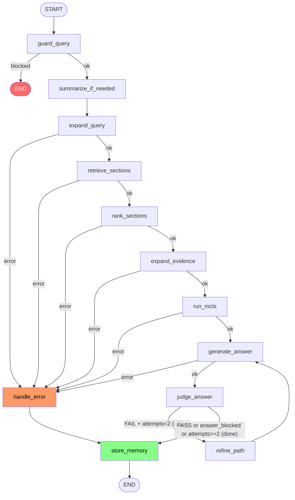

# LangGraph Agent — Pipeline Topology

Source of truth: `src/agent/graph.py` (`build_graph`). Diagram generated by reading
the actual `add_node`/`add_edge`/`add_conditional_edges` calls — not aspirational.

## Node reference

| Node | File | Purpose |
|---|---|---|
| `guard_query` | `nodes/guard.py` | Safety/scope classification; also detects `is_followup` (does query reference prior conversation). Fastpath keyword block + VLM fallback (fail-open on VLM error). |
| `summarize_if_needed` | `nodes/memory.py` | If `len(messages) > 10`: VLM-summarize the older ones, keep last 4. Runs regardless of `is_followup` — buffer-size management, not per-turn relevance. |
| `expand_query` | `nodes/retrieval.py` | Generates sub-queries. Uses `messages`/`summary` only if `is_followup=True` — otherwise treats query as standalone. |
| `retrieve_sections` | `nodes/retrieval.py` | BM25 only (no embeddings): the original query and the joined sub-questions, fused via Reciprocal Rank Fusion. BM25 seeds candidates and the MCTS prior. |
| `rank_sections` | `nodes/retrieval.py` | Hybrid score: normalized BM25 + VLM relevance judgment per candidate. Keeps top N. |
| `expand_evidence` | `nodes/retrieval.py` | Pulls in parent/sibling/child/related sections around the ranked set to build the evidence bundle. |
| `run_mcts` | `nodes/mcts.py` | Vectorless MCTS over the **full** section tree: PUCT descends from the chapters, each expansion scores a node's children with the VLM (chapters by subsection titles, leaves by content), BM25 only biases exploration. Strong sections the ranker missed are added to the evidence; `mcts_path` is the chapter → section chain of the best find. |
| `generate_answer` | `nodes/answer.py` | Synthesizes the final answer from evidence (+ conversation context if `is_followup`). `temperature=0.0`, `frequency_penalty=0.4` (anti repetition-loop on the 7B model). |
| `judge_answer` | `nodes/judge.py` | Two binary VLM calls: Layer A safety/grounding check, Layer B quality/gap-admission check. Not a single scored-JSON call — that self-contradicted on the 7B model. |
| `refine_path` | `nodes/mcts.py` | Runs its own `explorer.search()` with a patched path on judge FAIL, then feeds `generate_answer` directly (**not** back through `run_mcts` — that would discard the refined path with an unpatched rescore). |
| `handle_error` | `nodes/persistence.py` | Builds a fallback answer from whatever evidence exists; clears `error`. Always → `store_memory`. |
| `store_memory` | `nodes/persistence.py` | Persists to SQLite (`feedback`, `mcts_runs`), appends the turn to `messages`, flushes the audit trail (`logs/{conversation_id}_{timestamp}.log` + `.json` sidecar). |

## Key routing rules (`nodes/routing.py`)

- **`route_after_guard`**: `blocked` → `END` (skips summarization, retrieval, memory entirely). `ok` → continue.
- **`route_on_error`**: any node with `state["error"]` set → `handle_error`, otherwise continue. Applied uniformly to every node from `expand_query` through `generate_answer`.
- **`route_after_judge`**: `answer_blocked=True` (safety) → `done`, never retried. `verdict == "FAIL" and judge_attempts < 2` → `refine`. Otherwise → `done`. Max 2 refine attempts total.

## Memory model (state.py)

- `messages` / `summary` — canonical LangGraph conversation memory, held in `st.session_state` across a browser session. **Not checkpointed to disk** — `graph.py` supports an `AsyncSqliteSaver` checkpointer, but `app.py` always calls with `thread_id=None`, so it's never engaged in practice.
- `logs: Annotated[list[str], add]` — reducer-accumulated audit trail, one line per node, flushed to `logs/*.log` by `store_memory`. Human feedback (rating/correction submitted after the answer is shown) is a separate, later Streamlit interaction — it writes straight to SQLite (`feedback.rating`, `human_corrections`), **not** into this log file or the graph state (see `scripts/view_memory.py` to reconstruct conversation history from SQLite).
